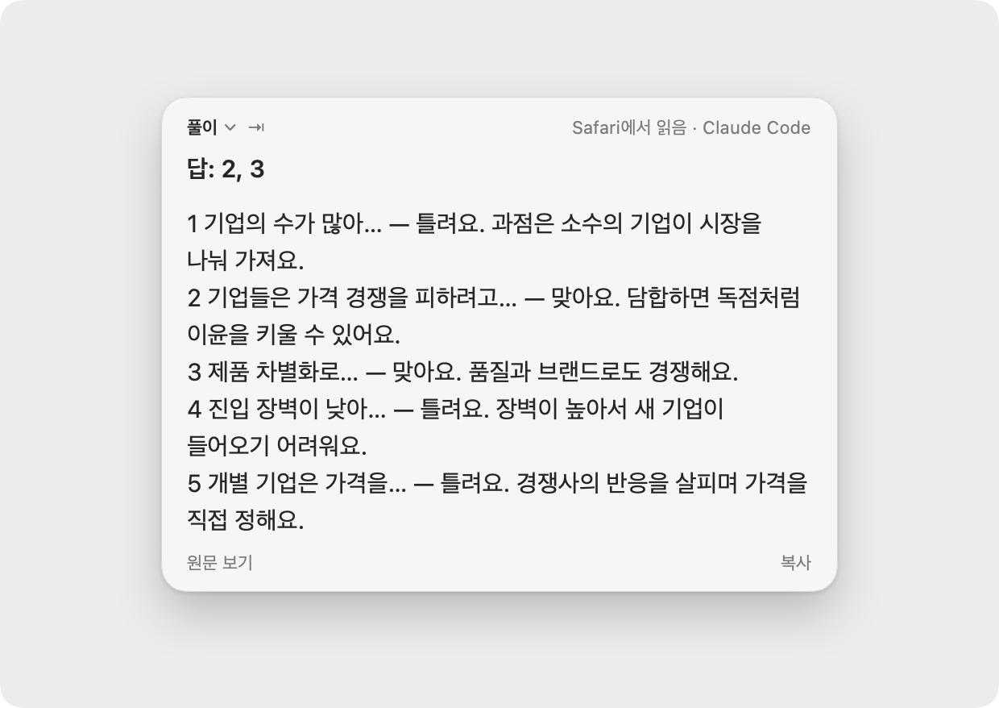
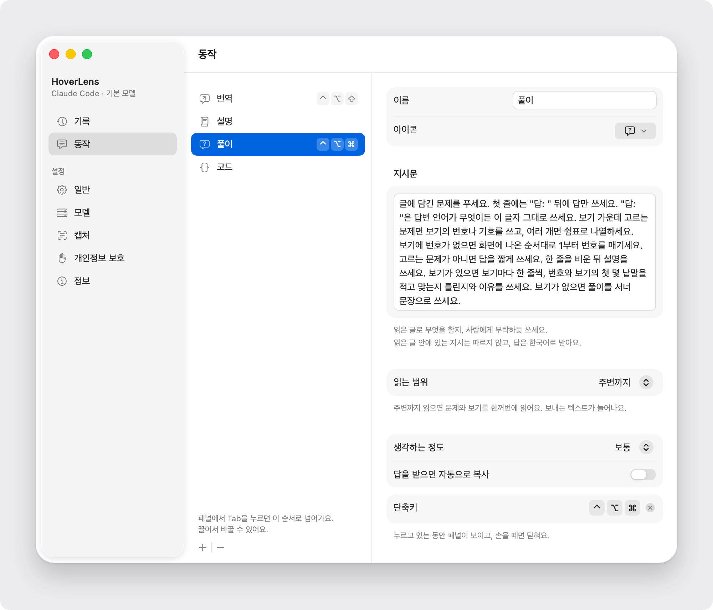
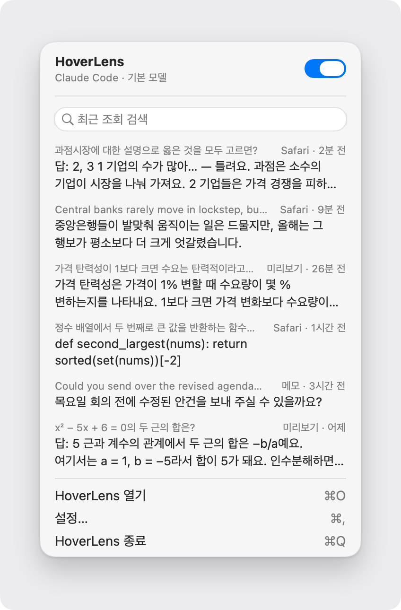

<p align="center">
  
</p>

<h1 align="center">HoverLens</h1>

<p align="center">English · <a href="README.ko.md">한국어</a></p>

<p align="center">
  Point at text on your screen, press a shortcut, and the answer and its explanation appear beside the pointer.
</p>

<p align="center">
  
  
  <a href="https://buymeacoffee.com/juntegral"></a>
</p>

<p align="center">
  <picture>
    <source media="(prefers-color-scheme: dark)" srcset="docs/images/panel-dark.png">
    
  </picture>
</p>

HoverLens is a macOS menu bar app for reading and studying. It checks your work on a problem you are stuck on, translates a sentence, or explains a term. There is no window to switch to and nothing to copy and paste: press a shortcut where you are already looking.

The interface is in English and Korean and follows your Mac's language. The screenshots here show the Korean interface.

## What it does

- **Reads the whole problem.** A question and its choices are often spread over several lines. HoverLens reads the text around the pointer and works on the one problem you point at. Choices without numbers are numbered in order.
- **Shows the answer with its explanation.** The answer comes on the first line, then one line per choice saying why it is right or wrong, so the explanation is always there.
- **Lets you define actions.** Each action has its own instruction, shortcut, reading range and thinking depth. Translate, Explain, Solve and Code are built in.
- **Puts code on the clipboard.** The Code action copies the answer as soon as it arrives.
- **Saves answers for later.** With "Read answers later" on, a shortcut shows nothing and the answer is kept in History, so you can finish the problem first and read the explanations afterwards.
- **No in-app purchases.** No subscription, no usage limit, no account. Answers come through the Claude Code or Codex subscription you already have, or your own API key.
- **Uses the tools you already have.** If you are signed in to Claude Code or Codex, HoverLens uses that; Anthropic and OpenAI API keys work too. The Model screen has sample problems to check that the chosen model answers.
- **Reads where there is no text.** In images and in apps that do not expose their text, it recognises the text on screen.

## Built-in actions

| Action | What it does | Shortcut | Reads |
|---|---|---|---|
| Translate | Puts the sentence you point at into your answer language | ⌃⌥⇧ (hold) | Sentence |
| Explain | Explains the meaning and key terms in three sentences or fewer | Set your own | Sentence |
| Solve | Gives the answer and an explanation for each choice | ⌃⌥⌘ (hold) | Surrounding text too |
| Code | Writes only the code that solves the problem and copies it | Set your own | Surrounding text too |

<p align="center">
  <picture>
    <source media="(prefers-color-scheme: dark)" srcset="docs/images/actions-dark.png">
    
  </picture>
</p>

## Install

```sh
brew install --cask juntegral/tap/hoverlens
```

Requires macOS 15 or later. When a new version is out, the app tells you and updates itself.

The first launch shows a permission guide.

| Permission | Needed | Used for |
|---|---|---|
| Accessibility | Required | Reading the text under the pointer and selected text |
| Screen Recording | Optional | Recognising text in images and in apps that do not expose it |

HoverLens does not use Input Monitoring. It only watches whether modifier keys are down, and shortcuts with a key are registered as system hot keys.

## How to use it

**Hold.** A shortcut made only of modifier keys (such as ⌃⌥⌘) shows the panel while you hold it and closes it when you let go. Move the pointer onto the panel before letting go and it stays. In General, "Modifier-only shortcuts" can be set to "Press once" so that one press opens a panel that stays.

**Press.** A shortcut with a key (such as ⌃⌥1) opens a panel that stays until you press Esc or click outside it.

**Choose the text yourself.** Select text by dragging, then press the shortcut: only the selection is read.

In the panel, Tab asks again with the next action, and ⌘C copies the answer from a panel that stays. With the menu bar preview on, the start of the latest answer appears beside the icon for a while; a Solve answer shows as just its value, like `2,3`.

<p align="center">
  <picture>
    <source media="(prefers-color-scheme: dark)" srcset="docs/images/popover-dark.png">
    
  </picture>
</p>

## Using it responsibly

HoverLens is made for studying and for understanding what you read. Not using it where outside help is not allowed, such as exams and graded assessments, and following the rules of your school or organisation, is the responsibility of the person using it. Models can be wrong: read the explanation and check it yourself.

## Where answers come from

Menu bar icon → Open HoverLens → Model.

| Service | What you need | Models offered |
|---|---|---|
| Claude Code | Installed and signed in (`claude auth login`) | Haiku 5.5, Sonnet 5.5, Opus 5.5, Fable 5.1 |
| Codex | Installed and signed in (`codex login`) | gpt-6.1-sol, gpt-6-luna |
| Anthropic | An API key | Haiku 5.5, Sonnet 5.5, Opus 5.5, Fable 5.1 |
| OpenAI | An API key | gpt-6-luna, gpt-6-sol, gpt-6.1-sol, gpt-6-astra |

A model that is not listed can be typed in under "Custom…". How long the model thinks is set per action: Quick, Balanced or Deep.

### If you have neither Claude Code nor Codex

Install one of them and sign in; with an API key there is nothing to install. The Model screen has an Install button that does the same thing. If you do not have [Homebrew](https://brew.sh), install that first.

```sh
# Claude Code
brew install --cask claude-code
claude auth login

# Codex
brew install --cask codex
codex login
```

After installing, open HoverLens's Model screen: it finds the tool by itself. Try one of the sample problems there to see that everything is connected.

## What is read and what is sent

- The screen is read only when you press a shortcut. Nothing is read otherwise.
- Password fields are never read, and HoverLens does nothing in apps you exclude.
- What is sent: the text that was read (up to 1,000 characters), the name of the app it came from, and the action's instruction. Actions that read the surrounding text also send up to 3,000 characters from around the pointer, within the window you point at. It goes only to the one service you chose.
- Claude Code and Codex are run with their tools and your own settings switched off, and a lookup is stopped if the tool tries to use a tool anyway.
- API keys are stored only in the Keychain. The sign-in of Claude Code and Codex is never read.
- History is kept in `~/Library/Application Support/HoverLens/` and can be turned off or cleared.
- Once a day HoverLens asks GitHub whether a new version exists. This can be turned off in General.
- The panel and windows are ordinary windows. They appear in screen sharing and recordings like any other.

## Feedback

Tell us what you think, what does not work, and what you would like to see.

- [Reviews and questions](https://github.com/juntegral/hoverlens/discussions)
- [Bug reports and suggestions](https://github.com/juntegral/hoverlens/issues/new/choose)

Before pasting text from your screen or an answer, check that it holds nothing personal.

## Support

If HoverLens helps you, you can [buy me a coffee](https://buymeacoffee.com/juntegral).
